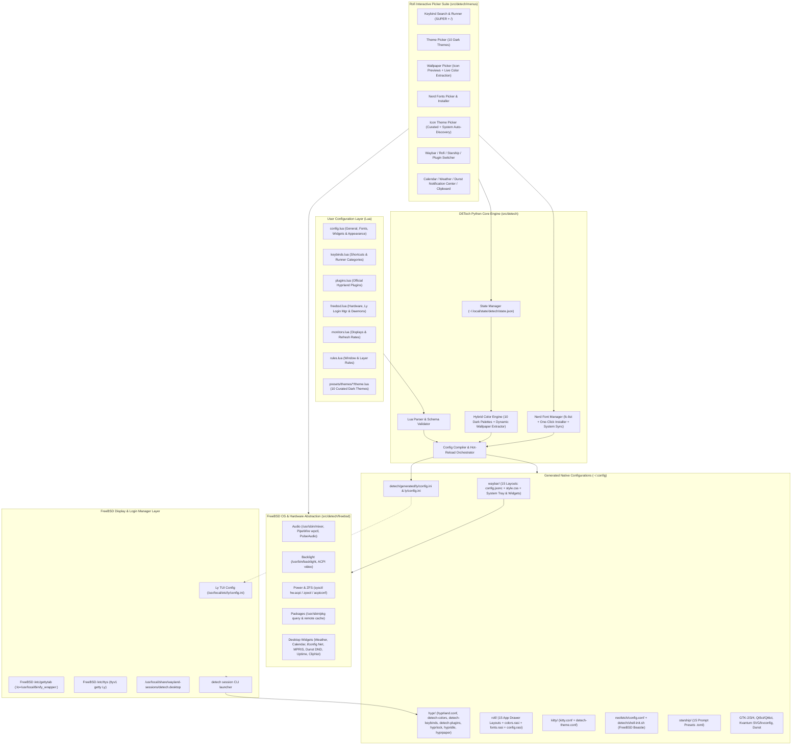
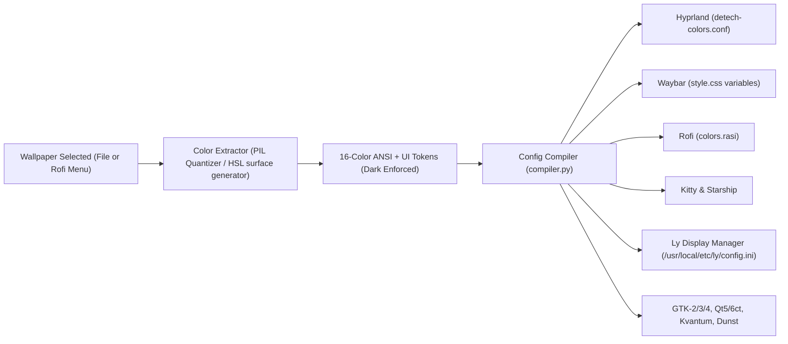

# DETech Architecture Guide

## Overview

**DETech (Desktop Environment Technology)** separates **user intent** (written in declarative Lua tables) from **tool-specific configuration syntax** (Hyprlang, Waybar JSONC/CSS, Rofi RASI, Kitty conf, Neofetch conf, POSIX shell startup hooks, Starship TOML, Dunst rc, GTK-2/3/4 INI/CSS, Qt5ct/Qt6ct, Kvantum SVG/kvconfig, and Ly TUI INI).



---

## Compilation & Hot-Reload Pipeline

Every time `detech apply`, `detech set ...`, or an interactive Rofi menu modifies the configuration, DETech executes an atomic compilation pass:

1. **Input Merging (`lua_loader.py` & `state.py`)**:
   - Reads base declarative Lua files from `~/.config/detech/` (falling back to repository `configs/lua/`).
   - Overlays mutable runtime overrides from `~/.local/state/detech/state.json` (such as active theme, dynamic wallpaper toggle, Waybar/Rofi/Starship/Hyprlock/plugin layout selections, icon pack, and Nerd Font family/size).
2. **Color & Icon Resolution (`color_engine.py` & `theme_menu.py`)**:
   - Loads the curated dark palette and default icon theme from `presets/themes/<active_theme>/theme.lua`.
   - If `dynamic_wallpaper_colors = true` and a wallpaper image is selected, extracts dominant chromatic tones using pure-Python quantization (with fallback to `wallust`/`matugen` if installed) and synthesizes a high-contrast 16-color ANSI + UI surface palette.
   - Enforces dark mode background luminance across all palettes for optimal contrast.
   - Auto-discovers installed icon packs in `/usr/local/share/icons`, `/usr/share/icons`, and `~/.local/share/icons` alongside 12 curated icon themes.
3. **Font Resolution (`font_manager.py`)**:
   - Resolves the active Nerd Font family (`mono`, `sans`) and sizes (`size`, `bar_size`, `rofi_size`, `lock_size`).
   - Validates font existence via `fc-list` and can install missing Nerd Fonts directly.
4. **Native Emission (`generators/*.py`)**:
   - **`hyprland.py`**: Emits Hyprland 0.56+ syntax into `~/.config/hypr/{hyprland,detech-colors,detech-keybinds,detech-plugins,hyprlock,hypridle,hyprpaper}.conf`.
   - **`waybar.py`**: Emits `~/.config/waybar/{config.jsonc,style.css}` and pre-compiles all 15 switchable layouts (`layouts/*.jsonc`, `styles/*.css`) integrating FreeBSD telemetry, Weather, Calendar, Network, MPRIS Media, Dunst Notification Center/DND, Uptime/Kernel, Clipboard, and System Tray modules.
   - **`rofi.py`**: Emits `~/.config/rofi/{colors,fonts,config,menu}.rasi` and all 15 app drawer layouts (`layouts/*.rasi`) synced with the active `icon_theme`, featuring chunky list items and minimalist separators.
   - **`terminal_shell.py`**: Emits `~/.config/kitty/{kitty,detech-theme}.conf`, `~/.config/starship.toml` (plus all 15 presets in `starship/presets/*.toml`), `~/.config/neofetch/config.conf` (themed FreeBSD Beastie system info), and `~/.config/detech/shell-init.sh` (interactive terminal startup hook for Neofetch + Starship).
   - **`gtk_qt_dunst.py`**: Emits `~/.config/gtk-2.0/gtkrc`, `~/.config/gtk-3.0/{settings.ini,gtk.css}`, `~/.config/gtk-4.0/{settings.ini,gtk.css}`, `~/.config/qt5ct/`, `~/.config/qt6ct/`, `~/.config/Kvantum/DETech/DETech.{kvconfig,svg}`, and `~/.config/dunst/dunstrc` (with notification history, recursive icon lookup, and OSD progress bars).
   - **`ly.py`**: Emits `~/.config/detech/generated/ly/config.ini` and `~/.config/ly/config.ini`, syncing directly with `/usr/local/etc/ly/config.ini` when writeable or symlinked.
5. **Hot Reload (`compiler.py`)**:
   - Hyprland: `hyprctl reload`
   - Wallpaper: `hyprctl hyprpaper reload` / `hyprctl hyprpaper wallpaper`
   - Waybar: `pkill -USR2 waybar` or clean layout restart
   - Kitty: `pkill -USR1 kitty` & dynamic color refresh
   - Dunst: `dunstctl reload`
   - GTK/Qt: `gsettings set org.gnome.desktop.interface ...`

---

## Display Manager & Session Architecture

DETech integrates the **Ly TUI Display Manager** directly with FreeBSD's system console and Wayland session architecture:

### 1. FreeBSD TTY & Gettytab Integration
- On FreeBSD, Ly operates on `ttyv1` via `/usr/libexec/getty`.
- `/etc/gettytab` defines the `Ly:` entry pointing to `/usr/local/bin/ly_wrapper` with `:al=root:`.
- `/etc/ttys` enables Ly on `ttyv1`:
  ```
  ttyv1  "/usr/libexec/getty Ly"  xterm  onifexists secure
  ```
- DETech provides `scripts/setup-ly.sh` to automate this configuration safely.

### 2. Wayland Session Desktop Entry
- Installs `/usr/local/share/wayland-sessions/detech.desktop`:
  ```ini
  [Desktop Entry]
  Name=DETech
  Comment=Desktop Environment Technology for FreeBSD (Hyprland)
  Exec=/usr/local/bin/detech session
  Type=Application
  DesktopNames=DETech;Hyprland
  ```
- Ly automatically detects and lists DETech as a selectable session.

### 3. Session Startup (`detech session`)
When selected in Ly or launched directly, `detech session`:
1. Executes `compile_all(reload_daemons=False)` to guarantee all configuration files are fully up to date with the user's latest Lua changes.
2. Locates the FreeBSD Hyprland binary (`/usr/local/bin/Hyprland` or `hyprland`).
3. Launches Hyprland with clean environment propagation.

### 4. 32-Bit Hex Ly Theming (`ly.py`)
Ly uses 32-bit hex colors formatted as `0xSSRRGGBB`:
- `SS`: Styling byte (`0x00` normal, `0x01` bold, `0x80` dim)
- `RRGGBB`: Red, Green, and Blue hex values
DETech's `ly.py` generator maps the active theme palette (`bg_primary`, `fg_primary`, `accent`, `border_active`, `urgent`) to these values and configures Ly's animations (`matrix`, `doom`, `colormix`, `gameoflife`), `bigclock`, and dialog layout.

---

## FreeBSD Telemetry & Waybar Widget Layer (`src/detech/freebsd/`)

DETech does not rely on Linux-specific filesystems like `/sys/class/power_supply` or Linux procfs. Instead, it provides native FreeBSD adapters:

- **`power.py`**:
  - Battery: `sysctl -n hw.acpi.battery.life`, `state`, `time`
  - Thermal: `sysctl -n hw.acpi.thermal.tz0.temperature`
  - System Load: `sysctl -n vm.loadavg`
  - Memory: `sysctl -n hw.physmem` and `vm.stats.vm`
  - ZFS: `zpool list -H -o name,size,alloc,free,cap,health`
  - Session Power: `doas acpiconf -s 3` (suspend), `shutdown -p now`, `shutdown -r now`, `hyprlock`
- **`audio.py` & `backlight.py`**:
  - Audio: FreeBSD native `/usr/sbin/mixer` (with automatic fallback to PipeWire `wpctl` or PulseAudio `pactl`)
  - Display: FreeBSD `/usr/bin/backlight` (with fallback to `sysctl hw.acpi.video`)
  - OSD: Sends formatted Dunst notifications with progress bar metadata
- **`pkg_manager.py`**:
  - FreeBSD `/usr/sbin/pkg`: local package queries (`pkg info`), remote searches (`pkg search`), updates checks, and package installs via floating terminal
- **`widgets.py` & `menus/widget_menus.py`**:
  - **Weather (`custom/weather`)**: Fetches `wttr.in` JSON with local cache (`~/.cache/detech/weather_*.json`) and auto-IP geolocation or explicit city override, paired with the Rofi 3-day forecast popup (`SUPER + M`).
  - **Calendar (`custom/calendar` & `clock`)**: Pango-highlighted monthly calendar tooltip + interactive Rofi month navigator (`SUPER + C`).
  - **Notifications & DND (`custom/dnd` / `custom/notifications`)**: Queries `dunstctl` for unread/history badge count, recent notification history in tooltip, interactive **Rofi Notification Center** (`SUPER + O`), and DND toggle (`SUPER + SHIFT + N`).
  - **FreeBSD Network (`custom/bsd-net`)**: Queries `ifconfig` for active Wi-Fi SSID (`wlan0`) or Ethernet (`em0`) and IPv4 address.
  - **MPRIS Media (`custom/media`)**: Queries `playerctl` for artist and title; handles click to play/pause and scroll for track navigation.
  - **FreeBSD Kernel & Uptime (`custom/bsd-uptime`)**: Queries `sysctl kern.boottime` and `kern.osrelease`, launching `detech fetch` on click.
  - **Clipboard (`custom/clipboard`)**: Queries `cliphist` item count and launches the Rofi clipboard history picker (`SUPER + Y`).

---

## Dynamic Color Engine & Wallpaper Pipeline



1. **Wallpaper Discovery & Previews**:
   - Scans `~/Pictures/Wallpapers` and theme asset directories.
   - Formats Rofi menu items with binary icon protocol metadata (`\0icon\x1f<path>`), rendering 64px image thumbnails inside the Rofi picker.
2. **Palette Synthesis**:
   - Dynamically analyzes the wallpaper image with PIL / Pillow, extracting primary, accent, and secondary tones.
   - Guarantees dark mode surface backgrounds with high-contrast text foregrounds (`fg_primary`, `fg_muted`).
3. **Propagation & Daemon Sync**:
   - Updates `~/.local/state/detech/state.json`.
   - Re-renders all configuration targets.
   - Re-applies wallpaper instantly via `hyprctl hyprpaper wallpaper` without restarting the compositor.
