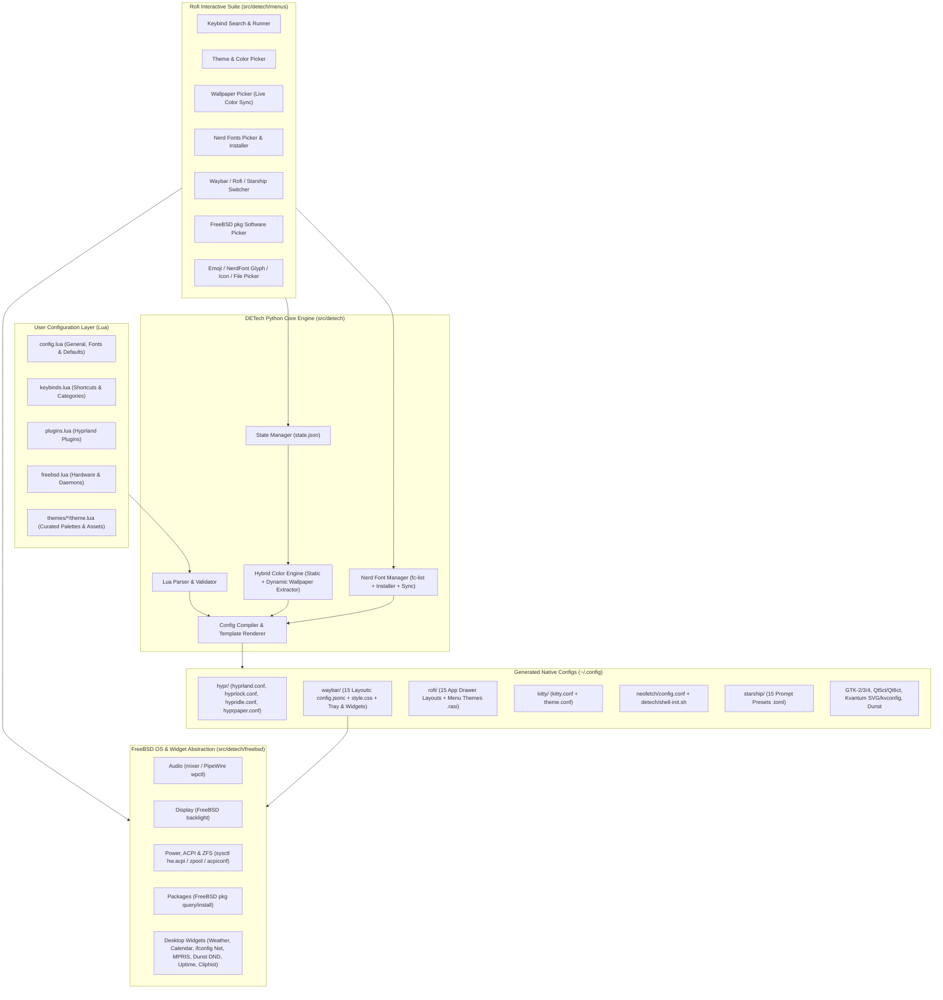

# DETech: FreeBSD Hyprland Desktop Environment — Implementation Plan

## Goal Description

**DETech (Desktop Environment Technology)** is a minimalist, modular, keyboard-centric desktop environment built around the **Hypr ecosystem** (`Hyprland`, `hyprlock`, `hypridle`, `hyprpaper`, and official Hyprland plugins) specifically engineered for **FreeBSD**.

Drawing architectural inspiration from **HyDE** (modular theming, rich Rofi pickers, seamless wallpaper/color switching) and **Ryoku** (declarative, cohesive configuration), DETech solves two major problems for FreeBSD Wayland users:
1. **Linux-isms in existing Hyprland dotfiles**: Most Hyprland rice projects hardcode Linux-specific utilities (`systemd`/`loginctl`, `/sys/class/power_supply`, `brightnessctl`, `pacman`/`apt`, `nmcli`). DETech provides a first-class **FreeBSD Hardware & OS Abstraction Layer** (`backlight`, `mixer`/`wpctl`, `sysctl hw.acpi`, `acpiconf`, `ifconfig`/`wpa_cli`, `seatd`/`consolekit2`, `pkg`).
2. **Fragmented configuration formats**: Instead of manually editing scattered `.conf`, `.jsonc`, `.css`, `.rasi`, `.toml`, and `.ini` files across `~/.config`, users configure their entire desktop in clean, modular **Lua configuration files** (`~/.config/detech/*.lua`). A lightweight **Python Engine (`detech`)** compiles these Lua definitions, merges them with active theme/wallpaper palettes and selected Nerd Fonts, and generates native configuration files with instant hot-reload.



---

## Key Architectural Decisions

> [!IMPORTANT]
> **Declarative Lua Configuration Engine**:
> To ensure zero fragile external compilation steps on FreeBSD while supporting full Lua syntax, DETech's Python engine supports `lupa` (LuaJIT bindings for Python) with a built-in pure-Python Lua-table parser fallback. This guarantees `detech` works even in a minimal bootstrap environment before C extensions are compiled.

> [!NOTE]
> **Hybrid Color Scheme & Nerd Font Pipeline**:
> - **Colors**: Selecting a **Theme** loads its curated palette from `themes/<theme>/theme.lua`. Selecting a **Wallpaper** (when dynamic colors are enabled) extracts a 16-color + surface palette in Python (with optional `wallust`/`matugen` hook support) and live-reloads all apps.
> - **Nerd Fonts**: Selecting a **Nerd Font** via the Rofi Nerd Fonts Picker (`SUPER + SHIFT + F` or `detech menu fonts`) updates the active font across **Kitty, Waybar, Rofi, Hyprlock, Dunst, GTK-3/4, and Qt5/Qt6** simultaneously, and can also install missing Nerd Fonts on FreeBSD into `~/.local/share/fonts/NerdFonts` (via `fc-cache -fv` or FreeBSD `pkg`).

> [!TIP]
> **Phased Implementation Strategy**:
> - **Phase 1 (Initial Execution Pass)**: Complete Python CLI & Core Engine, Lua loader/compiler, FreeBSD hardware wrappers, all 8 Rofi interactive pickers (including the Nerd Fonts picker), FreeBSD bootstrap script, and **3 complete flagship themes + 3 Waybar layouts + 3 Rofi layouts + 3 Starship prompts** with full unit/integration tests.
> - **Phase 2**: Expansion of the preset library to all **15 Waybar layouts**, **15 Rofi app drawer layouts**, and **15 Starship prompts**.
> - **Phase 3**: Additional curated theme packs, GTK/Qt/Kvantum asset bundles, and Hyprland plugin presets (`hyprbars`, `hyprexpo`, `hyprtrails`, `csgo-vulkan-fix`).

---

## Proposed Changes

### 1. Repository Scaffolding & Project Packaging

Sets up a clean, installable Python package (`detech`) alongside the modular Lua configs, presets, and FreeBSD installation scripts.

```
DETech/
├── pyproject.toml
├── README.md
├── LICENSE
├── docs/
│   ├── project-description.md
│   ├── implementation-plan.md
│   └── architecture.md
├── configs/
│   └── lua/
│       ├── config.lua          # Main user entry point (general, fonts, appearance)
│       ├── keybinds.lua        # Categorized keyboard shortcuts
│       ├── monitors.lua        # Display & workspace definitions
│       ├── rules.lua           # Window & layer rules
│       ├── plugins.lua         # Hyprland plugins config
│       └── freebsd.lua         # FreeBSD hardware & session settings
├── presets/
│   ├── themes/                 # Theme packs (bsd-crimson, ryoku-matcha, hyde-catppuccin, ...)
│   ├── waybar/                 # 10-20 switchable Waybar layouts
│   ├── rofi/                   # 10-20 switchable Rofi app drawer layouts
│   ├── starship/               # 10-20 switchable Starship prompt presets
│   └── hyprlock/               # Screen lock layouts
├── scripts/
│   └── install-freebsd.sh      # FreeBSD pkg & seatd/dbus bootstrap script
├── src/
│   └── detech/
│       ├── __init__.py
│       ├── cli.py              # Main `detech` CLI entrypoint
│       ├── core/               # Lua loader, state, color engine, font manager, compiler
│       ├── freebsd/            # FreeBSD hardware & OS adapters
│       ├── generators/         # Native config emitters (Hypr, Waybar, Rofi, etc.)
│       └── menus/              # Rofi interactive pickers (including Nerd Fonts picker)
└── tests/                      # Pytest suite
```

#### [NEW] pyproject.toml
Defines `detech` CLI entry points (`detech`, `detech-menu`, `detech-bsd`) and minimal dependencies (`pillow` for fast pure-Python wallpaper color extraction, optional `lupa`).

---

### 2. Declarative Lua Configuration Layer (`configs/lua/`)

Users customize DETech entirely through human-friendly Lua tables. Every keybind includes a `description` and `category` so the Rofi Keybind Search & Runner menu can both display and execute any shortcut on demand.

#### [NEW] config.lua
```lua
-- ~/.config/detech/config.lua
return {
    general = {
        terminal = "kitty",
        file_manager = "thunar",
        browser = "firefox",
        editor = "nvim",
        notification_daemon = "dunst", -- "dunst" or "mako"
    },
    fonts = {
        mono = "JetBrainsMono Nerd Font",
        sans = "JetBrainsMono Nerd Font Propo",
        size = 11,
        bar_size = 11,
        rofi_size = 12,
        lock_size = 48,
    },
    appearance = {
        theme = "bsd-crimson",           -- Active theme pack
        dynamic_wallpaper_colors = true, -- Extract palette when wallpaper changes
        waybar_layout = "island-top",    -- 1 of 10-20 waybar layouts
        rofi_layout = "grid-cards",      -- 1 of 10-20 rofi app drawer layouts
        starship_preset = "tokyo-pill",  -- 1 of 10-20 starship prompts
        hyprlock_layout = "minimal-clock",
        icon_theme = "Papirus-Dark",
        gaps_in = 6,
        gaps_out = 12,
        border_size = 2,
        rounding = 10,
        blur = { enabled = true, size = 6, passes = 3 },
        animations = "snappy",           -- "snappy", "smooth", "minimal", "disabled"
    },
    input = {
        kb_layout = "us",
        kb_options = "caps:escape",
        follow_mouse = 1,
        touchpad_natural_scroll = true,
    },
}
```

#### [NEW] keybinds.lua
```lua
-- ~/.config/detech/keybinds.lua
local mod = "SUPER"

return {
    main_mod = mod,
    binds = {
        -- System & Session
        { mod = {mod}, key = "Return", action = "exec", arg = "kitty", category = "System", desc = "Launch Kitty Terminal" },
        { mod = {mod}, key = "Q", action = "killactive", arg = "", category = "Window", desc = "Close active window" },
        { mod = {mod}, key = "L", action = "exec", arg = "hyprlock", category = "Session", desc = "Lock screen (hyprlock)" },

        -- DETech Rofi Pickers
        { mod = {mod}, key = "D", action = "exec", arg = "detech menu apps", category = "Launcher", desc = "App Drawer (Rofi)" },
        { mod = {mod}, key = "Slash", action = "exec", arg = "detech menu keybinds", category = "DETech", desc = "Search & Run Keyboard Shortcuts" },
        { mod = {mod, "SHIFT"}, key = "T", action = "exec", arg = "detech menu themes", category = "DETech", desc = "Switch System Theme" },
        { mod = {mod, "SHIFT"}, key = "W", action = "exec", arg = "detech menu wallpapers", category = "DETech", desc = "Pick Wallpaper & Sync Colors" },
        { mod = {mod, "SHIFT"}, key = "F", action = "exec", arg = "detech menu fonts", category = "DETech", desc = "Nerd Fonts Picker & Installer" },
        { mod = {mod, "SHIFT"}, key = "I", action = "exec", arg = "detech menu icons", category = "DETech", desc = "Icon Theme Picker" },
        { mod = {mod, "SHIFT"}, key = "C", action = "exec", arg = "detech menu colors", category = "DETech", desc = "Color Scheme Picker" },
        { mod = {mod, "SHIFT"}, key = "B", action = "exec", arg = "detech menu waybar", category = "DETech", desc = "Switch Waybar Layout (10-20)" },
        { mod = {mod, "SHIFT"}, key = "R", action = "exec", arg = "detech menu rofi-layout", category = "DETech", desc = "Switch Rofi Layout (10-20)" },
        { mod = {mod, "SHIFT"}, key = "P", action = "exec", arg = "detech menu starship", category = "DETech", desc = "Switch Starship Prompt (10-20)" },
        { mod = {mod}, key = "E", action = "exec", arg = "detech menu files", category = "Launcher", desc = "Rofi File Browser" },
        { mod = {mod}, key = "S", action = "exec", arg = "detech menu software", category = "FreeBSD", desc = "FreeBSD pkg Software Picker" },
        { mod = {mod}, key = "Period", action = "exec", arg = "detech menu glyphs", category = "Launcher", desc = "Emoji, NerdFont Glyph & Symbol Picker" },

        -- FreeBSD Hardware Keys
        { mod = {}, key = "XF86AudioRaiseVolume", action = "exec", arg = "detech bsd audio up 5", category = "Hardware", desc = "Increase Volume" },
        { mod = {}, key = "XF86AudioLowerVolume", action = "exec", arg = "detech bsd audio down 5", category = "Hardware", desc = "Decrease Volume" },
        { mod = {}, key = "XF86AudioMute", action = "exec", arg = "detech bsd audio mute", category = "Hardware", desc = "Toggle Audio Mute" },
        { mod = {}, key = "XF86MonBrightnessUp", action = "exec", arg = "detech bsd backlight up 5", category = "Hardware", desc = "Increase Screen Brightness" },
        { mod = {}, key = "XF86MonBrightnessDown", action = "exec", arg = "detech bsd backlight down 5", category = "Hardware", desc = "Decrease Screen Brightness" },
    }
}
```

#### [NEW] plugins.lua
Manages official Hyprland plugins (`hyprbars`, `hyprexpo`, `hyprtrails`, `hyprwinwrap`) and their per-plugin configuration tables.

#### [NEW] freebsd.lua
Configures FreeBSD-specific backends:
- Audio backend preference: `"auto"` (`wpctl` -> `pactl` -> FreeBSD native `/usr/sbin/mixer`)
- Backlight device: `"/dev/backlight/backlight0"` (via `/usr/bin/backlight`)
- Session manager: `"seatd"` or `"consolekit2"`
- Package escalation tool: `"doas"` or `"sudo"` (defaulting to `doas` as idiomatic on FreeBSD)

---

### 3. Python Core Engine, Color System & Nerd Font Manager (`src/detech/core/`)

#### [NEW] lua_loader.py
Loads user and preset `.lua` configuration files into validated Python data structures. Uses `lupa.LuaRuntime` when installed, and includes a built-in recursive Lua table lexer/parser (`local` variable resolution + nested tables + comments) so DETech has zero hard C-extension blockers.

#### [NEW] state.py
Tracks runtime mutable selections in `~/.local/state/detech/state.json` (active theme, current wallpaper path, active Nerd Font family & size, active waybar layout, active rofi layout, active starship preset, active icon pack, dynamic color mode toggle) so Rofi pickers can switch presets instantaneously without overwriting the user's base `config.lua` unless requested (`detech save`).

#### [NEW] color_engine.py
Implements the **Hybrid Color Scheme System**:
1. **Curated Theme Palette**: Reads 16 ANSI colors + semantic UI tokens (`bg_primary`, `bg_secondary`, `fg_primary`, `accent`, `urgent`, `border_active`, `border_inactive`, `gtk_theme`, `icon_theme`, `cursor_theme`, `kvantum_theme`) from `presets/themes/<name>/theme.lua`.
2. **Dynamic Wallpaper Palette Extractor**:
   - Extracts dominant and accent chromatic colors from the selected wallpaper image (pure Python quantizer / HSL-luminance adjuster, plus optional delegation to `wallust` or `matugen` if available in `$PATH`).
   - Generates harmonious dark/light surface shades and high-contrast foregrounds.
   - Emits normalized color formats (`#RRGGBB`, `rgb(r,g,b)`, `rgba(r,g,b,a)`, `0xffRRGGBB` for Hyprland) consumed by all generators.

#### [NEW] font_manager.py
Manages **Nerd Fonts discovery, switching, and installation**:
1. **Curated Nerd Font Catalog**: Built-in metadata for 16+ popular Nerd Fonts (`JetBrainsMono Nerd Font`, `FiraCode Nerd Font`, `CaskaydiaCove Nerd Font`, `Hack Nerd Font`, `Iosevka Nerd Font`, `MesloLGS Nerd Font`, `GeistMono Nerd Font`, `0xProto Nerd Font`, `CommitMono Nerd Font`, `Mononoki Nerd Font`, `UbuntuMono Nerd Font`, `SourceCodePro Nerd Font`, `VictorMono Nerd Font`, `SpaceMono Nerd Font`, `ZedMono Nerd Font`, `Inconsolata Nerd Font`).
2. **System Discovery (`fc-list`)**: Scans installed fonts on FreeBSD via `fc-list : family` and tags installed vs. available-to-install Nerd Fonts.
3. **One-Click Nerd Font Installer**: Can install either the FreeBSD `x11-fonts/nerd-fonts` port/pkg or download and extract a single selected Nerd Font release archive directly into `~/.local/share/fonts/NerdFonts/<FontName>/` and refresh `fc-cache -fv`.
4. **System-Wide Propagation**: Updates `state.json` and triggers `compiler.py` so Kitty, Waybar, Rofi, Hyprlock, Dunst, and GTK/Qt all switch to the chosen Nerd Font family and size immediately.

#### [NEW] compiler.py
Orchestrates all config generators when `detech apply` or any picker action runs, writes target files atomically, and triggers non-disruptive hot-reloads:
- `hyprctl reload`
- `hyprctl hyprpaper wallpaper ...`
- `pkill -USR2 waybar` or restart waybar layout
- `kitty @ set-colors --all` & Kitty config reload (`pkill -USR1 kitty`)
- `gsettings set org.gnome.desktop.interface font-name / gtk-theme / icon-theme ...` (for GTK-3/4)

---

### 4. FreeBSD Hardware & OS Integration (`src/detech/freebsd/`)

Replaces Linux-only commands with native FreeBSD utilities and provides JSON output for Waybar custom modules and OSD notifications via `notify-send`.

#### [NEW] audio.py
- Auto-detects FreeBSD audio stack: PipeWire (`wpctl`), PulseAudio (`pactl`), or FreeBSD native OSS (`mixer vol +5%` / `mixer vol.mute=^`).
- Sends OSD notification with progress bar (`dunstify`/`notify-send -h int:value:...`).

#### [NEW] backlight.py
- Interfaces with FreeBSD's native `/usr/bin/backlight` (`backlight + 5`, `backlight - 5`, `backlight -q`).
- Fallback to `sysctl hw.acpi.video.lcd0.brightness` for older ACPI drivers.

#### [NEW] power.py
- Queries FreeBSD battery & thermal state via `sysctl -n hw.acpi.battery.life`, `hw.acpi.battery.state`, `hw.acpi.battery.time`, and `hw.acpi.thermal.tz0.temperature`.
- Provides suspend (`acpiconf -s 3` or `zzz`), reboot, and poweroff actions compatible with `seatd` and `doas`.

#### [NEW] pkg_manager.py
- Interfaces with FreeBSD `/usr/sbin/pkg`:
  - `pkg search` / `pkg rquery "%n|%c|%v"` (cached locally for instant Rofi filtering)
  - `pkg info` for installed packages
  - Launches Kitty floating window running `doas pkg install <pkg>` or `doas pkg delete <pkg>` when chosen from the Rofi software picker.

#### [NEW] widgets.py
- Powers the Waybar desktop & FreeBSD telemetry widgets (`detech bsd widgets <widget> --json`):
  - **Weather (`custom/weather`)**: Fetches live conditions and a 3-day forecast from `wttr.in` with local cache (`~/.cache/detech/weather_*.json`) and auto-IP geolocation or explicit city override.
  - **Calendar (`custom/calendar`)**: Generates a Pango-formatted monthly calendar grid highlighting the current day in the active theme's accent color.
  - **Notifications & DND (`custom/dnd` / `custom/notifications`)**: Queries `dunstctl` for waiting/history counts, recent notification summaries, DND state, and `close-all`/`history-pop`/`history-clear` actions.
  - **FreeBSD Network (`custom/bsd-net`)**: Parses `ifconfig` output for active Wi-Fi SSID (`wlan0`) or Ethernet (`em0`) and IPv4 address.
  - **MPRIS Media (`custom/media`)**: Queries and controls `playerctl` (`play-pause`, `next`, `prev`).
  - **FreeBSD Kernel & Uptime (`custom/bsd-uptime`)**: Queries `sysctl kern.boottime` and `kern.osrelease`.
  - **Clipboard (`custom/clipboard`)**: Queries and clears `cliphist` history.

---

### 5. Native Config Generators (`src/detech/generators/`)

Each generator transforms the merged `(Lua Config + Runtime State + Color Palette + Active Nerd Font)` into clean, commented native files:

#### [NEW] hyprland.py
Generates modular Hyprland configs under `~/.config/hypr/`:
- `hyprland.conf` (sources modular files)
- `detech-colors.conf` (border gradients, shadow colors)
- `detech-keybinds.conf` (compiled from `keybinds.lua`)
- `detech-plugins.conf` (compiled from `plugins.lua` for official Hyprland plugins)
- `hyprlock.conf` (using active Nerd Font and theme colors), `hypridle.conf` (using FreeBSD `acpiconf`/`hyprctl dispatch dpms`), and `hyprpaper.conf`.

#### [NEW] waybar.py
Compiles the selected Waybar layout (`1..15`) with FreeBSD-native modules (`custom/bsd-battery`, `custom/bsd-audio`, `custom/bsd-temp`, `custom/bsd-load`, `custom/bsd-mem`, `custom/bsd-zfs`, `custom/bsd-pkg`, `custom/bsd-net`, `custom/bsd-uptime`, `custom/weather`, `custom/calendar`, `custom/media`, `custom/dnd`, `custom/clipboard`, `tray`, `hyprland/workspaces`, `hyprland/window`) and injects the active theme CSS variables and **active Nerd Font** into `style.css`.

#### [NEW] rofi.py
Generates `~/.config/rofi/colors.rasi`, `~/.config/rofi/fonts.rasi` (with active Nerd Font & size), `~/.config/rofi/config.rasi` (synced with active `icon_theme`), and pre-compiles all 15 app drawer layouts (`rofi/layouts/*.rasi`).

#### [NEW] terminal_shell.py
- Generates `~/.config/kitty/detech-theme.conf` & `kitty.conf` (with active Nerd Font `font_family`, `bold_font`, `italic_font`, and `font_size`).
- Generates `~/.config/starship.toml` from the selected Starship preset (`1..15`) with theme-matched palette and Nerd Font powerline/glyph symbols.
- Generates `~/.config/neofetch/config.conf` (themed FreeBSD Beastie ASCII art, OS, kernel, uptime, packages, Hyprland WM, DETech theme, icon theme, Waybar/Starship presets, Nerd Font, CPU, GPU, memory, ZFS root pool) and `~/.config/detech/shell-init.sh` to auto-display Neofetch on interactive terminal launch.

#### [NEW] gtk_qt_dunst.py
- Generates `~/.config/gtk-2.0/gtkrc`, `~/.config/gtk-3.0/{settings.ini,gtk.css}`, `~/.config/gtk-4.0/{settings.ini,gtk.css}` (custom color overrides, `gtk-icon-theme-name`, and `gtk-font-name` set to active Nerd Font), `~/.config/qt5ct/qt5ct.conf` & `colors/detech.conf`, `~/.config/qt6ct/qt6ct.conf` & `colors/detech.conf`, `~/.config/Kvantum/DETech/DETech.{kvconfig,svg}`, and `~/.config/dunst/dunstrc` (with notification history, recursive icon lookup, and OSD progress bars).

---

### 6. Rofi Interactive Picker Suite (`src/detech/menus/`)

All menus use Rofi's script/dmenu mode with custom `.rasi` layouts, Nerd Font icons, and instant preview/apply actions:

#### [NEW] keybinds_menu.py
Reads `keybinds.lua`, formats every shortcut as `[Category]  SUPER + Key  ⟶  Description`, allows fuzzy search in Rofi, and **immediately executes the selected `hyprctl dispatch <action> <arg>`** upon pressing Enter.

#### [NEW] font_menu.py
**Nerd Fonts Picker & Installer (`detech menu fonts` / `SUPER + SHIFT + F`)**:
- Displays installed Nerd Fonts (`✓ Installed`) at the top and downloadable Nerd Fonts (`⬇ Install`) below, along with a **Font Size adjuster** (`10pt`..`16pt`).
- Selecting an installed Nerd Font immediately applies it system-wide across Kitty, Waybar, Rofi, Hyprlock, Dunst, and GTK/Qt.
- Selecting an uninstalled Nerd Font downloads and installs it to `~/.local/share/fonts/NerdFonts/`, runs `fc-cache -fv`, and applies it.

#### [NEW] theme_menu.py & wallpaper_menu.py
- **Theme Picker (`detech menu themes`)**: Lists available themes with color swatches, switches theme, icon pack, GTK/Qt scheme, and wallpaper.
- **Color Scheme Picker (`detech menu colors`)**: Switches palette independently of layout/wallpaper or toggles Static vs. Dynamic Wallpaper extraction.
- **Icon Picker (`detech menu icons`)**: Lists 12 curated icon themes (`Papirus-Dark`, `Papirus-Light`, `Papirus`, `Tela-circle-dark`, `Tela-circle`, `Catppuccin-SE`, `Gruvbox-Plus-Dark`, `TokyoNight-SE`, `Nordzy-dark`, `Qogir-dark`, `Breeze-Dark`, `Numix-Circle`, `Adwaita`) plus any custom icon packs auto-discovered in `/usr/local/share/icons` and `~/.local/share/icons`, syncing GTK-2/3/4, Qt5/6, Rofi, Dunst, and Neofetch.
- **Wallpaper Picker (`detech menu wallpapers`)**: Scans `~/Pictures/Wallpapers` and theme wallpaper directories, renders Rofi icon previews (`\0icon\x1f/path/to/wall`), applies via `hyprpaper`, and triggers `color_engine` to update system-wide colors.

#### [NEW] widget_menus.py
Interactive Rofi popups for Waybar widgets:
- **Interactive Calendar (`detech menu calendar` / `SUPER + C`)**: Month-by-month navigable calendar grid.
- **Weather Forecast (`detech menu weather` / `SUPER + M`)**: Current conditions and 3-day forecast popup.
- **Notification Center (`detech menu notifications` / `SUPER + O`)**: Browse `dunstctl` notification history, pop individual notifications, dismiss all, clear history, or toggle Do Not Disturb.
- **Clipboard History (`detech menu clipboard` / `SUPER + Y`)**: Browse, decode, and copy `cliphist` entries via `wl-copy` or wipe clipboard history.

#### [NEW] layout_menu.py
Interactive switchers for:
- **Waybar Layouts (10–20 layouts)** (`detech menu waybar`)
- **Rofi App Drawer Layouts (10–20 layouts)** (`detech menu rofi-layout`)
- **Starship Prompts (10–20 prompts)** (`detech menu starship`)

#### [NEW] pkg_menu.py
FreeBSD Software Center in Rofi (`detech menu software`): browse installed packages or search the FreeBSD `pkg` repository and install/remove in a themed floating Kitty terminal.

#### [NEW] glyph_emoji_menu.py & file_browser.py
- **Glyph / Emoji / NerdFont Symbol Picker (`detech menu glyphs`)**: Searchable catalog of Nerd Font glyphs (Devicons, FontAwesome, Material, Octicons, Powerline) + Unicode emojis; copies selected glyph to Wayland clipboard via `wl-copy`.
- **Rofi File Browser (`detech menu files`)**: Fast directory navigation opening files in `nvim`, `xdg-open`, or `thunar`.

---

### 7. Preset Catalog (Themes, 15 Waybar Layouts, 15 Rofi Layouts, 15 Starship Prompts)

To satisfy the 10–20 layout requirement while keeping the repository modular, presets are organized as data-driven blueprints under `presets/`:

| Category | Count | Included Presets (Phase 1 Flagships in **Bold**) |
| :--- | :---: | :--- |
| **Themes** | 5+ | **`bsd-crimson`** (FreeBSD daemon dark red), **`ryoku-matcha`** (everforest/matcha green), **`hyde-catppuccin`** (mocha lavender), `tokyo-cyber`, `nordic-frost` |
| **Waybar Layouts** | 15 | **`island-top`** (floating pills), **`minimal-bar`** (ultra-thin edge-to-edge), **`dock-bottom`** (macOS/HyDE dock + top status), `vertical-left`, `vertical-right`, `split-wings`, `cyber-angled`, `compact-center`, `dual-bar`, `retro-box`, `glass-full`, `workspace-centric`, `capsules-dark`, `zen-status`, `freebsd-telemetry` |
| **Rofi App Drawers** | 15 | **`grid-cards`** (icon grid 4x3), **`spotlight-minimal`** (centered search bar), **`sidebar-left`** (full-height drawer), `sidebar-right`, `fullscreen-launchpad`, `compact-list`, `dual-pane`, `floating-dock`, `cyber-hud`, `retro-terminal`, `banner-header`, `pill-launcher`, `category-tabs`, `mini-palette`, `hyde-classic` |
| **Starship Prompts** | 15 | **`tokyo-pill`** (powerline rounded pills), **`minimal-lambda`** (clean `λ` two-line), **`bsd-devil`** (FreeBSD-themed transient style), `gruv-ribbon`, `cyber-brackets`, `pure-clone`, `matrix-grid`, `compact-git`, `neon-arrow`, `monochrome-zen`, `boxed-tree`, `pastel-blocks`, `time-right`, `devops-status`, `ryoku-clean` |

---

### 8. FreeBSD Installer & Bootstrap (`scripts/install-freebsd.sh`)

#### [NEW] install-freebsd.sh
Idempotent POSIX shell script (`/bin/sh` compatible for FreeBSD):
1. Verifies FreeBSD OS (`uname -s == FreeBSD`).
2. Installs required FreeBSD packages via `pkg install`:
   `hyprland`, `hyprlock`, `hypridle`, `hyprpaper`, `waybar`, `rofi`, `kitty`, `starship`, `dunst`, `wl-clipboard`, `seatd`, `dbus`, `fontconfig`, `nerd-fonts`, `python312`, `py312-pillow`, `qt5ct`, `qt6ct`, `papirus-icon-theme`.
3. Checks `/etc/rc.conf` for `seatd_enable="YES"` and `dbus_enable="YES"`.
4. Installs the `detech` CLI and seeds `~/.config/detech/` with the default Lua configurations.

---

## Verification Plan

### Automated Tests
We will include a comprehensive `pytest` suite (`tests/`) that works both in CI/development environments and on FreeBSD:
```bash
pytest -v tests/
```
1. **`tests/test_lua_loader.py`**: Verifies parsing of `config.lua`, `keybinds.lua`, `plugins.lua`, `freebsd.lua`, and theme `.lua` files using both `lupa` and the built-in pure-Python Lua table parser.
2. **`tests/test_color_engine.py`**: Verifies static theme loading and dynamic wallpaper palette extraction (using a generated test image) and checks contrast/format outputs (`#hex`, `rgba()`, `0xff...`).
3. **`tests/test_font_manager.py`**: Verifies Nerd Font catalog listing, `fc-list` output parsing, font switching in `state.json`, and propagation of the selected Nerd Font across Kitty, Waybar, Rofi, Hyprlock, Dunst, and GTK/Qt configs.
4. **`tests/test_generators.py`**: Runs `detech apply --output-dir <tmp>` and validates that generated `hyprland.conf`, `hyprlock.conf`, `waybar/config.jsonc`, `waybar/style.css`, `rofi/config.rasi`, `kitty.conf`, `starship.toml`, `dunstrc`, and GTK/Qt configs are syntactically valid and contain expected keybinds, Nerd Fonts, and colors.
5. **`tests/test_freebsd_adapters.py`**: Mocks `subprocess.run` for FreeBSD `mixer`, `backlight`, `sysctl hw.acpi`, and `pkg rquery` to verify command construction and output parsing.
6. **`tests/test_menus.py`**: Verifies Rofi menu entry generation and dispatch logic for keybinds, themes, wallpapers, Nerd Fonts, icons, layouts, and glyphs.

### Manual Verification
1. Run `detech status` and `detech apply --dry-run` to inspect compiled configuration output.
2. Test Nerd Font switching (`detech set font "JetBrainsMono Nerd Font" --size 12`) and layout switching (`detech set waybar minimal-bar`, `detech set rofi spotlight-minimal`, `detech set starship minimal-lambda`) and verify generated files in `~/.config/`.
3. On a FreeBSD + Hyprland session, press `SUPER + /` to open the Rofi Keybind Search menu or `SUPER + SHIFT + F` to open the Rofi Nerd Fonts Picker.
