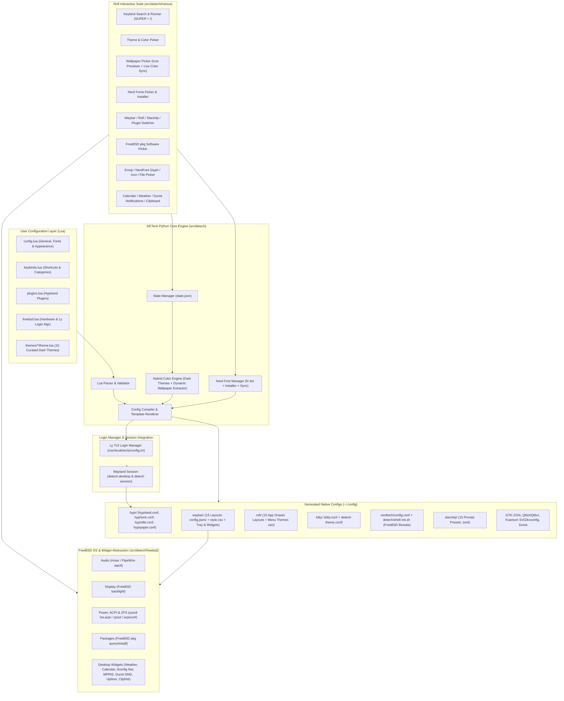

# DETech: FreeBSD Hyprland Desktop Environment — Implementation Plan & Status

## Goal Description

**DETech (Desktop Environment Technology)** is a minimalist, modular, keyboard-centric desktop environment built around the **Hypr ecosystem** (`Hyprland`, `hyprlock`, `hypridle`, `hyprpaper`, and official Hyprland plugins) specifically engineered for **FreeBSD**.

Drawing architectural inspiration from **HyDE** (modular theming, rich Rofi pickers, seamless wallpaper/color switching) and **Ryoku** (declarative, cohesive configuration), DETech solves two major problems for FreeBSD Wayland users:
1. **Linux-isms in existing Hyprland dotfiles**: Most Hyprland rice projects hardcode Linux-specific utilities (`systemd`/`loginctl`, `/sys/class/power_supply`, `brightnessctl`, `pacman`/`apt`, `nmcli`). DETech provides a first-class **FreeBSD Hardware & OS Abstraction Layer** (`backlight`, `mixer`/`wpctl`, `sysctl hw.acpi`, `acpiconf`, `ifconfig`/`wpa_cli`, `seatd`/`consolekit2`, `pkg`).
2. **Fragmented configuration formats**: Instead of manually editing scattered `.conf`, `.jsonc`, `.css`, `.rasi`, `.toml`, and `.ini` files across `~/.config`, users configure their entire desktop in clean, modular **Lua configuration files** (`~/.config/detech/*.lua`). A lightweight **Python Engine (`detech`)** compiles these Lua definitions, merges them with active theme/wallpaper palettes and selected Nerd Fonts, and generates native configuration files with instant hot-reload.



---

## Implementation Status Summary

All planned phases and extensions have been successfully implemented and tested:

| Milestone / Phase | Status | Summary of Delivered Capabilities |
| :--- | :---: | :--- |
| **Phase 1: Core Engine & Adapters** | **Completed** | Python CLI (`detech`), Lua parser with fallback, state management, hybrid color engine, font manager, FreeBSD adapters (`mixer`, `backlight`, `sysctl`, `pkg`), and initial generators. |
| **Phase 2: Preset Library Expansion** | **Completed** | Full suite of **15 Waybar layouts**, **15 Rofi app drawer layouts**, and **15 Starship prompt presets**, with ZFS telemetry, weather, calendar, DND, and network widgets. |
| **Phase 3: Curated Themes & Asset Bundles** | **Completed** | **10 Curated Dark Themes**, GTK-2/3/4 CSS overrides, Qt5ct/Qt6ct color schemes, Kvantum SVG asset generator, Dunst theme matching, and 6 official Hyprland plugin presets. |
| **Extension: Ly TUI Display Manager** | **Completed** | FreeBSD `/etc/gettytab` (`ly_wrapper`) & `/etc/ttys` integration, 32-bit hex theme generation (`ly.py`), TUI animations (`matrix`, `doom`), big clock, `scripts/setup-ly.sh`, and `detech session`. |
| **Refinement: Hyprland 0.56+ & Dark Palettes** | **Completed** | Hyprland 0.56+ syntax migration, dark color palette enforcement across all themes, chunky Rofi list items, minimalist separators, and wallpaper icon previews. |

---

## Architectural Highlights

> [!IMPORTANT]
> **Declarative Lua Configuration Engine**:
> To ensure zero fragile external compilation steps on FreeBSD while supporting full Lua syntax, DETech's Python engine supports `lupa` (LuaJIT bindings for Python) with a built-in pure-Python Lua-table parser fallback. This guarantees `detech` works even in a minimal bootstrap environment before C extensions are compiled.

> [!NOTE]
> **Hybrid Color Scheme & Nerd Font Pipeline**:
> - **Colors**: Selecting a **Theme** loads its curated palette from `presets/themes/<theme>/theme.lua`. Selecting a **Wallpaper** (when dynamic colors are enabled) extracts a 16-color + surface palette in Python (with optional `wallust`/`matugen` hook support) and live-reloads all apps.
> - **Nerd Fonts**: Selecting a **Nerd Font** via the Rofi Nerd Fonts Picker (`SUPER + SHIFT + F` or `detech menu fonts`) updates the active font across **Kitty, Waybar, Rofi, Hyprlock, Dunst, GTK-3/4, and Qt5/Qt6** simultaneously, and can also install missing Nerd Fonts on FreeBSD into `~/.local/share/fonts/NerdFonts` (via `fc-cache -fv` or FreeBSD `pkg`).

> [!TIP]
> **Ly TUI Display Manager & Session Integration**:
> DETech configures the lightweight C TUI display manager **Ly** on FreeBSD console (`ttyv1`). The theme colors of the login screen automatically update whenever the user switches DETech themes or wallpapers, matching the desktop aesthetic before login.

---

## Repository Structure

```
DETech/
├── pyproject.toml
├── README.md
├── LICENSE
├── docs/
│   ├── project-description.md      # Project overview and goals
│   ├── architecture.md             # System architecture and pipeline
│   ├── implementation-plan.md      # Implementation status and roadmap
│   └── configuration-guide.md      # In-depth Lua configuration reference
├── configs/
│   └── lua/
│       ├── config.lua              # Main user entry point (general, fonts, appearance)
│       ├── keybinds.lua            # Categorized keyboard shortcuts & runner metadata
│       ├── monitors.lua            # Display & workspace definitions
│       ├── rules.lua               # Window & layer rules
│       ├── plugins.lua             # Official Hyprland plugins config
│       └── freebsd.lua             # FreeBSD hardware & Ly login manager settings
├── presets/
│   ├── themes/                     # 10 Curated dark theme packs
│   ├── waybar/                     # 15 Switchable Waybar layouts
│   ├── rofi/                       # 15 Switchable Rofi app drawer layouts
│   ├── starship/                   # 15 Switchable Starship prompt presets
│   ├── hyprplugins/                # 6 Hyprland plugin presets
│   └── hyprlock/                   # 14 Screen lock layouts (10 theme-matched + 4 classic)
├── scripts/
│   ├── install-freebsd.sh          # FreeBSD pkg, Zsh default shell, seatd/dbus & user configs installer
│   └── setup-ly.sh                 # Ly TUI login manager installer, Zsh shell check & console config
├── src/
│   └── detech/
│       ├── __init__.py
│       ├── cli.py                  # Main `detech` CLI entrypoint & subcommands
│       ├── core/                   # Lua loader, state, color engine, font manager, compiler
│       ├── freebsd/                # FreeBSD hardware, telemetry & widget adapters
│       ├── generators/             # Native config emitters (Hypr, Waybar, Rofi, Ly, etc.)
│       └── menus/                  # Rofi interactive pickers & widget popups
└── tests/                          # Automated test suite
```

---

## Detailed Component Architecture

### 1. Declarative Lua Configuration Layer (`configs/lua/`)

- `config.lua`: General desktop defaults, terminal info (`neofetch`), widgets (weather, calendar, network, media, dnd, tray, uptime, clipboard), active fonts, appearance options, and autostart processes.
- `freebsd.lua`: Hardware adapter settings (`audio`, `backlight`, `power`, `pkg`) and `login_manager` options for Ly (`animation`, `bigclock`, `box_title`, `auto_login_user`).
- `keybinds.lua`: Comprehensive keyboard shortcuts with category metadata powering `SUPER + /` search and execution.
- `plugins.lua`: Hyprland plugin blueprints (`hyprbars`, `hyprexpo`, `hyprtrails`, `hyprwinwrap`, `csgo_vulkan_fix`, `borders_plus_plus`).
- `monitors.lua`: Monitor resolution, positioning, and refresh rates.
- `rules.lua`: Floating window rules, opacity settings, and blur layer rules.

### 2. Python Core Engine (`src/detech/core/`)

- `lua_loader.py`: Dual-backend loader supporting `lupa` and pure-Python recursive token parsing.
- `state.py`: Manages `~/.local/state/detech/state.json` for mutable runtime overrides without modifying base files.
- `color_engine.py`: Dark-enforced palette synthesizer with static theme loader and pure-Python PIL wallpaper quantizer.
- `font_manager.py`: Catalog of 16+ Nerd Fonts with `fc-list` discovery, one-click installer, and system-wide synchronization.
- `compiler.py`: Atomic native configuration renderer with non-disruptive daemon reloads (`hyprctl`, `waybar`, `kitty`, `dunstctl`, `gsettings`).

### 3. Native Configuration Generators (`src/detech/generators/`)

- `hyprland.py`: Generates `hyprland.conf`, `detech-colors.conf`, `detech-keybinds.conf`, `detech-plugins.conf`, `hyprlock.conf`, `hypridle.conf`, and `hyprpaper.conf` with Hyprland 0.56+ syntax.
- `waybar.py`: Compiles 15 distinct Waybar layouts and dynamic CSS stylesheets incorporating all FreeBSD widgets and the system tray.
- `rofi.py`: Generates `colors.rasi`, `fonts.rasi`, `config.rasi`, and 15 app drawer layouts with chunky list items and minimalist separators.
- `terminal_shell.py`: Emits `kitty.conf` (configured with Zsh as default shell), `detech-theme.conf`, 15 Starship prompt presets (`starship.toml`), themed Neofetch configuration, and `shell-init.sh` (integrating Zsh completions, autosuggestions, and syntax highlighting).
- `gtk_qt_dunst.py`: Emits GTK-2/3/4 settings, Qt5ct/Qt6ct color schemes, Kvantum SVG themes, and `dunstrc`.
- `ly.py`: Emits themed Ly `config.ini` files with 32-bit hex colors, matrix/doom animations, and big clock styling.

### 4. FreeBSD Adapters & Widget Layer (`src/detech/freebsd/`)

- `audio.py`: Native `/usr/sbin/mixer` adapter with PipeWire/PulseAudio fallback and OSD notifications.
- `backlight.py`: FreeBSD `/usr/bin/backlight` control with ACPI video fallback.
- `power.py`: FreeBSD ACPI battery (`hw.acpi.battery`), thermal (`hw.acpi.thermal`), load average, physical memory, and ZFS pool health.
- `pkg_manager.py`: FreeBSD `pkg` local query and remote search cache.
- `widgets.py`: Backend data formatting for Waybar widgets (Weather `wttr.in`, Interactive Calendar, Dunst DND, FreeBSD Network, MPRIS, Kernel/Uptime, Clipboard).

### 5. Rofi Interactive Picker Suite (`src/detech/menus/`)

- `keybinds_menu.py` (`SUPER + /`): Fuzzy search and execute any keyboard shortcut directly.
- `theme_menu.py` (`SUPER + SHIFT + T`): Switch among 10 curated dark themes.
- `wallpaper_menu.py` (`SUPER + SHIFT + W`): Wallpaper browser with 64px image icon previews and dynamic color extraction.
- `font_menu.py` (`SUPER + SHIFT + F`): Nerd Fonts picker and installer.
- `layout_menu.py`: Switchers for Waybar (`SUPER + SHIFT + B`), Rofi (`SUPER + SHIFT + R`), Starship (`SUPER + SHIFT + P`), Hyprland plugins (`SUPER + SHIFT + G`), and Hyprlock (`SUPER + SHIFT + L`).
- `widget_menus.py`: Popups for Interactive Calendar (`SUPER + C`), Weather Forecast (`SUPER + M`), Clipboard History (`SUPER + Y`), and Notification Center (`SUPER + O`).
- `pkg_menu.py` (`SUPER + S`), `glyph_emoji_menu.py` (`SUPER + .`), and `file_browser.py` (`SUPER + E`).

---

## Verification & Test Results

The test suite covers all generators, adapters, menus, and color pipelines:
- `tests/test_lua_loader.py`: Validates parsing of all Lua configuration files and themes.
- `tests/test_color_engine.py`: Verifies dark palette luminance enforcement and dynamic wallpaper color extraction.
- `tests/test_font_manager.py`: Verifies Nerd Font discovery, installation routines, and propagation.
- `tests/test_generators.py`: Validates syntax and content of generated Hyprland, Waybar, Rofi, Kitty, Starship, Dunst, GTK/Qt, and Ly configurations.
- `tests/test_freebsd_adapters.py`: Tests command construction and output parsing for FreeBSD `mixer`, `backlight`, `sysctl`, and `pkg`.
- `tests/test_menus.py`: Validates Rofi menu entries, icon protocol formatting, and keybind execution dispatching.
